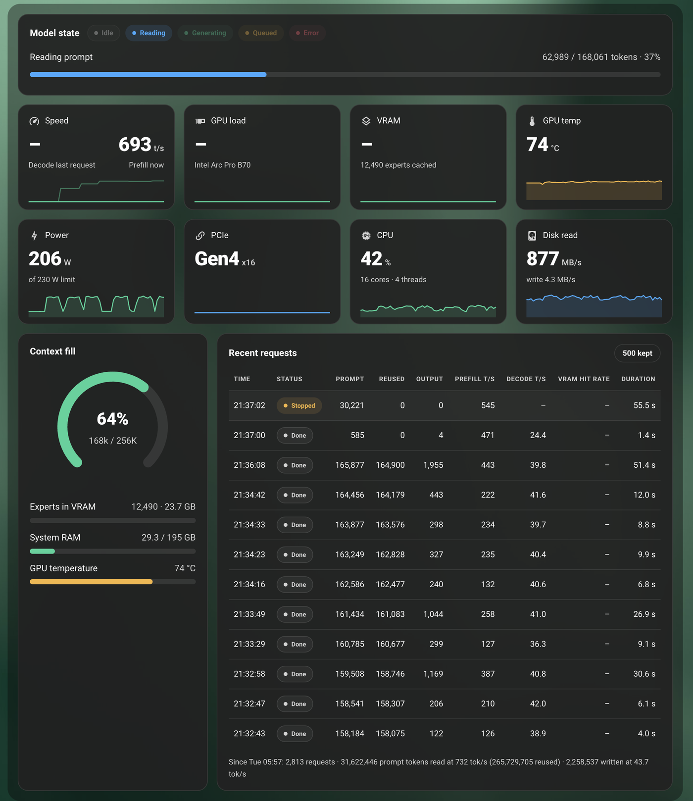
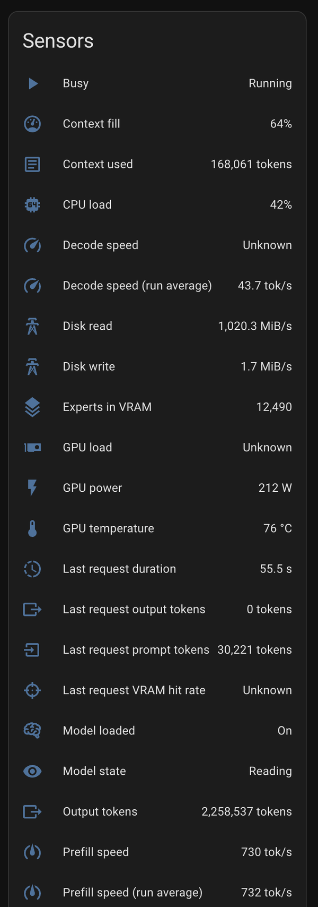

# Strata for Home Assistant

Fully AI generated with Opus 5.5

A Home Assistant integration for the [Strata](https://github.com/Niko1221/Strata) local LLM inference server.
It reads the server's monitoring feed (`GET /metrics`, the data behind Strata's own Monitor tab), exposes the KPIs as
sensors, and ships a dashboard card, `custom:strata-card`, laid out like the Monitor tab.





## Requirements

- Home Assistant 2025.1 or newer
- A Strata server that Home Assistant can reach over the network

## Prepare the Strata server

Strata listens on `127.0.0.1:8095` by default, so only the machine it runs on can reach it. For Home Assistant to
connect, start it with `--host 0.0.0.0` (or `"host"` in its run config); `--port` changes the port. Strata's own
documentation advises setting an API key whenever the server listens beyond `127.0.0.1`: `--api-key <key>` or the
`STRATA_API_KEY` environment variable. `/metrics` requires that key; `/health` does not.

Check the connection from the Home Assistant host:

```sh
curl -s -H "Authorization: Bearer <api-key>" http://<strata-host>:<port>/metrics | head -c 300
```

A JSON response means Home Assistant will be able to connect. If the two run in different networks or VLANs, a
firewall rule must allow Home Assistant to reach the Strata port.

## Install

### Marketplace (recommended)

1. In Home Assistant, open the Marketplace and choose **Add from a GitHub link**.
2. Paste `https://github.com/steffenschlueter/strata-homeassitant-integration` and select **Add**.
3. Install **Strata**.
4. **Restart Home Assistant.** New integrations are only picked up at startup.

New releases appear as updates in the Marketplace. After updating, restart Home Assistant and reload the browser page.

### HACS

1. In HACS, open the ⋮ menu → **Custom repositories**.
2. Add `https://github.com/steffenschlueter/strata-homeassitant-integration` with type **Integration**.
3. Search for **Strata**, download it, and restart Home Assistant.

### Manual

Copy `custom_components/strata` from this repository to `<config>/custom_components/strata` and restart Home Assistant.

## Set up

**Settings → Devices & services → Add integration → Strata**

| Field | Description |
|---|---|
| Host | IP address or domain of the Strata server, for example `192.0.2.10`, `192.0.2.10:8095` or `strata.example.net`. A pasted URL such as `http://192.0.2.10:8095/` works too. |
| Port | Strata's port, `8095` unless changed with `--port`. Leave empty when the server sits behind a reverse proxy on the standard port (80, or 443 with HTTPS). A port entered here overrides one written in Host. |
| Use HTTPS | On for an HTTPS reverse proxy. A pasted `https://` URL turns it on. |
| Verify SSL certificate | Turn off only for a self-signed certificate. |
| API key | The server's `--api-key`. Leave empty if none is set. |

- **Reconfigure** on the integration entry changes host, port or HTTPS later without removing the integration.
- **Configure** sets the polling interval (2–300 s, default 5 s). The server samples its hardware once a second and
  keeps 60 seconds of history.
- If the API key changes on the server, Home Assistant asks for the new one.

## Sensors

| Entity | Description |
|---|---|
| Model state | `idle`, `reading`, `generating`, `queued` or `unloaded` |
| Queued requests | Requests waiting their turn |
| Decode speed, Prefill speed | Live while a request runs, otherwise the last request |
| Decode / Prefill speed (run average) | Token-weighted averages since the server started |
| GPU load, VRAM used, GPU temperature, GPU power | GPU readings; the power sensor carries the power limit as an attribute |
| PCIe link, PCIe to GPU | Link generation and width; transfer rate (disabled by default) |
| CPU load, System RAM used, Disk read, Disk write | Host readings |
| Context used, Context fill, Max context | Context of the running request, otherwise the last one |
| Experts in VRAM, Expert cache size | Mixture-of-experts cache on the GPU |
| Model | Loaded model |
| Last request prompt tokens, output tokens, duration, VRAM hit rate | The most recent request |
| Requests, Prompt tokens read, Prompt tokens reused, Output tokens | Totals since the server started; a server restart resets them, which Home Assistant's statistics handle |
| Model loaded, Busy | Binary sensors |
| Monitor | Diagnostic sensor that feeds the card |

Some readings depend on the GPU driver. Where Strata gets no value (for example GPU load and VRAM usage on Intel Arc
with the `xe` driver), the sensor shows *unknown* and the card shows "–", as Strata's own Monitor does.

Disk and PCIe rates are reported in MiB/s; the card labels them MB/s like Strata's Monitor.

Entity IDs follow the device name and area, for example `sensor.strata_monitor` or `sensor.<area>_strata_monitor`.
The device page under **Settings → Devices & services** lists the actual IDs.

## The card

The integration serves the card and loads it on every dashboard, so no resource needs to be added. Reload the browser
page once after setting up the integration, then add the card from the card picker (**Strata Monitor**) or in YAML.
The card has a visual editor with checkboxes for sections and tiles.

```yaml
type: custom:strata-card
# entity: sensor.strata_monitor        # optional; found automatically when there is one Strata server
# title: Strata                        # optional, replaces "Model state"
# sections: [state, metrics, context, requests]   # optional, default all
# metrics: [speed, gpu_load, vram, gpu_temp, power, pcie, cpu, disk]   # optional: which tiles, in this order
# columns: 4                           # optional: tiles per row (default: up to 4)
# max_requests: 12                     # optional, the server sends the last 12
```

The full card is designed for a wide layout: use a **Panel** view, or full width in a **Sections** view.

**Single stats.** With only the `metrics` section, each tile is drawn as a card of its own, so one stat per card works:

```yaml
type: custom:strata-card
sections: [metrics]
metrics: [power]
```

```yaml
type: custom:strata-card
sections: [metrics]
metrics: [cpu, power, gpu_temp]
columns: 3
```

Clicking a tile opens the matching sensor's history. Colours follow the Home Assistant theme with Strata's green, blue
and amber accents; the theme variables `strata-tile-background` and `strata-border-color` override the tile background
and border.

## Troubleshooting

**"Custom element doesn't exist: strata-card"**

1. Make sure the integration is set up (it appears under **Settings → Devices & services**) and reload the page
   with a hard refresh (Cmd/Ctrl+Shift+R). In the Companion app: **Settings → Companion app → Debugging → Reset
   frontend cache**.
2. Open `http://<home-assistant>:8123/strata_static/strata-card.js`. If it shows JavaScript, the card is installed.
3. If the error remains, register the card manually: enable **Advanced mode** in your user profile, then
   **Settings → Dashboards → ⋮ → Resources → Add resource**, URL `/strata_static/strata-card.js`, type
   **JavaScript module**, and reload the page.

**"Cannot reach a Strata server"** during setup: check the `curl` command from [Prepare the Strata server](#prepare-the-strata-server)
from the Home Assistant host, and that Strata listens on `0.0.0.0` rather than `127.0.0.1`.

## Recorder

The Monitor sensor carries the snapshot for the card (history, last requests) as attributes that are not written to
the recorder, but the sensor still updates on every poll. To keep it out of the database entirely:

```yaml
recorder:
  exclude:
    entity_globs:
      - sensor.*strata_monitor*
```

## Development

```sh
pip install -r requirements_test.txt
pytest
```

The fixtures in `tests/fixtures/` follow the payload of `GET /metrics` as built by `Service.metrics()` in Strata's
`serve/server.py`.

## Credits

Not affiliated with the Strata project. The card's layout and its formulas (prefill excluding reused tokens, context
fill, run averages) follow Strata's Monitor tab, `serve/web/app.js` in
[Niko1221/Strata](https://github.com/Niko1221/Strata) (MIT License).
